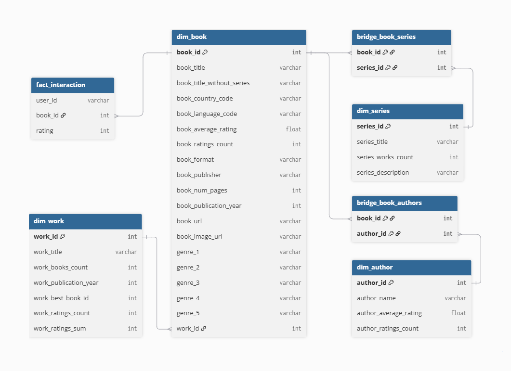
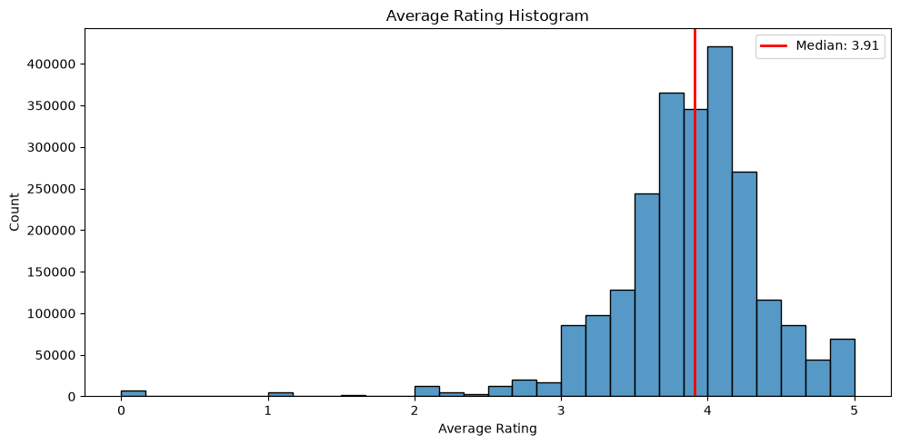
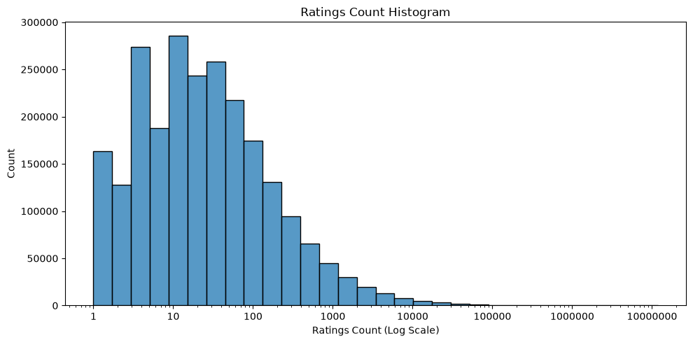
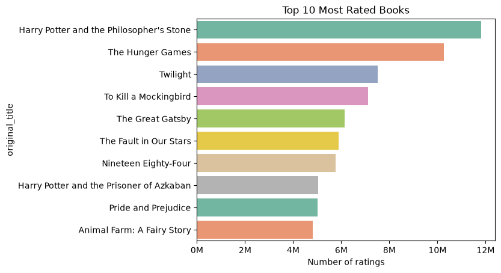
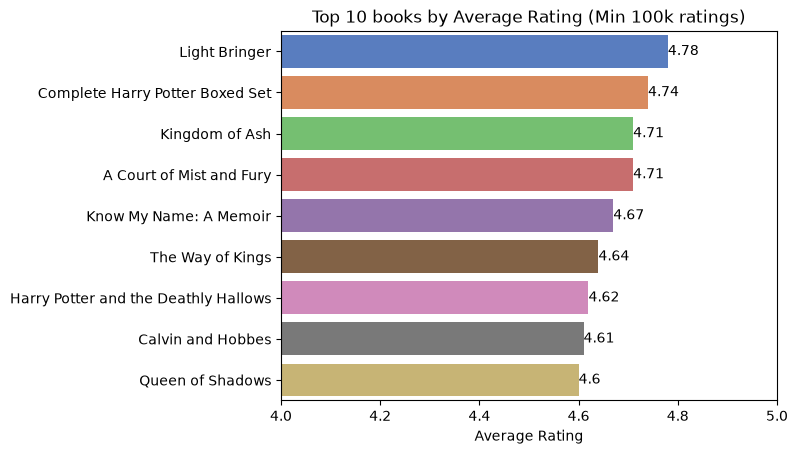
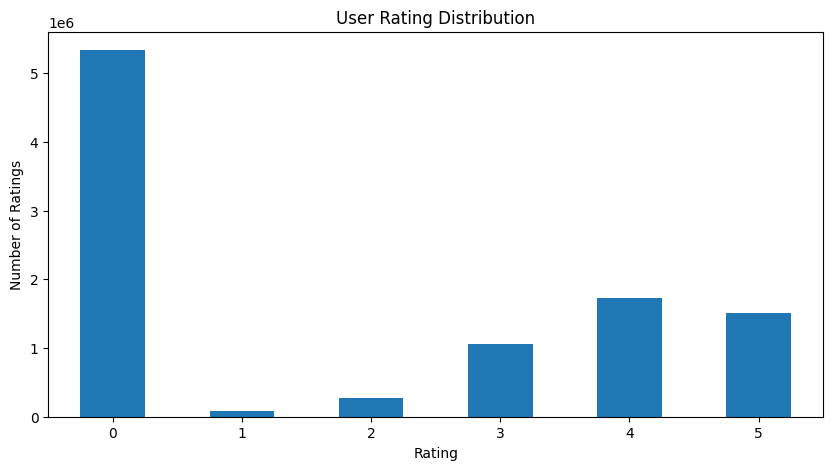
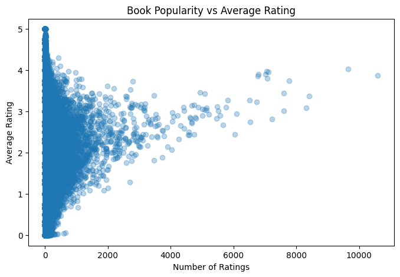
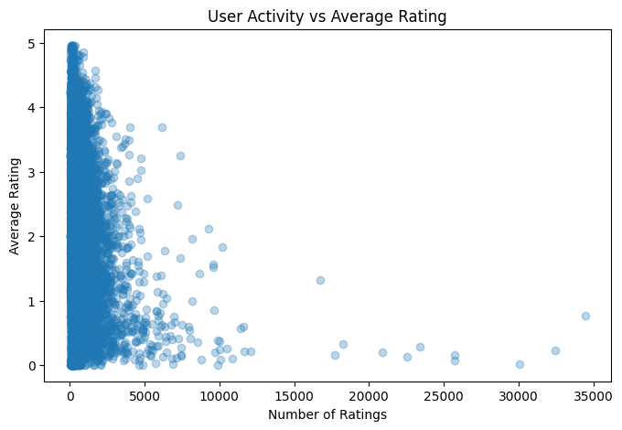
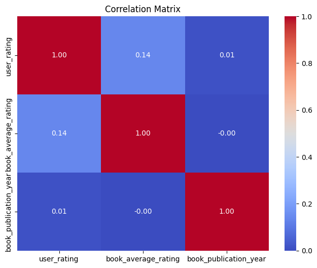

# Goodreads Data Project

### Book Recommendation System Using the Goodreads Dataset

---

## 1. Overview

This project builds a **book recommendation system** on top of large-scale Goodreads data.

It covers four stages: **Data Engineering**, building a **Data Warehouse**, **Exploratory Data Analysis (EDA)**, and **Recommendation Modeling**.

The goal is to turn a set of fairly messy, heterogeneous Goodreads sources into a structured warehouse and a few analytical data marts, use those to understand ratings, book popularity, and reader behavior, and then build and compare several recommender models that suggest books a reader is likely to enjoy.

> **Scope:** Data Engineering → Data Warehouse → EDA → Recommendation Models

---

## 2. Problem Statement

An average rating alone doesn't tell you much about how popular or how reliable a book's score actually is.

Two books can both sit at 4.5 stars, yet one has thousands of ratings and the other only a few dozen — same score, very different amount of evidence behind it.

Readers also differ a lot in what they like — genre, author, series, language, publication era, or just how generously they rate. So the questions this project tries to answer are:

> **What patterns show up in Goodreads ratings, book popularity, and reader preferences?**
>
> **Given what a reader has already liked, which unread books should we recommend?**

The second question is a **top-N recommendation** problem, not a rating-prediction problem. This shapes how the models are evaluated

---

## 3. Dataset

The project combines two sources.

### 3.1 UCSD Goodreads Dataset

The main source is the **UCSD Goodreads Dataset** from UC San Diego, which includes book metadata, authors, works, series, genres, users, user–book interactions, and ratings/reviews. The original data was collected up to late **2017**.

Source: https://cseweb.ucsd.edu/~jmcauley/datasets/goodreads.html

### 3.2 Additional Scraped Data

Since the UCSD dataset is an older snapshot, we also scrape more recent Goodreads data with **[Apify](https://apify.com/epctex/goodreads-scraper)** — book ID, title, author, rating, rating count, format, page count, publication date, publisher, language, series, Goodreads URL, and cover image.

This scraped data is used to add new books, refresh rating info on books already in the warehouse, and fill in gaps left by the older UCSD snapshot.

### 3.3 Dataset Scale

Combining both sources, the project currently works with approximately:

| Data | Amount |
|---|---:|
| Books | ~2.36 million |
| Authors | ~830,000 |
| Original user–book interactions | ~228.6 million |

---

## 4. Data Engineering Pipeline

```
01_create_dw.sql
 └── 02_load_dw.sql     <--- [UCSD Datasets]
      └── 02_load_dw_scrapped.sql       <--- [Scrapped Data]
           └── 03_create_dm.sql
                └── EDA
```

**Extract** — raw data comes from UCSD's `.json.gz` files plus the Apify-scraped Goodreads data.

**Transform** — standardize fields, handle missing values, drop duplicate book records, map relationships between books, works, authors and series, prepare rating/interaction data, and merge scraped info into what's already in the warehouse.

**Load** — write the transformed data into a **DuckDB-based Data Warehouse**.



---

## 5. Analytical Data Marts

Two marts sit on top of the warehouse:

- **`mart_book_statistics`** — book-level info (authors, series, genres, ratings, rating counts, publication info, page counts), used for book-level EDA and as book metadata for the content-based model.
- **`mart_user_ratings`** — user rating info joined with book attributes, used to look at rating behavior, rating distributions, user activity, and how individual ratings relate to a book's overall rating. A sampled version of the user–book interactions is the input to the recommender models.

---

## 6. Data Preprocessing

Because the data comes from multiple sources, it has its share of missing or inconsistent values. Main steps: dedupe scraped book records, standardize column names and types, map languages to standard codes, handle missing values depending on the analysis, check book–work relationships, merge in scraped rating info, and filter out values that don't fit a given analysis.

We don't blanket-drop every row with a missing value — a missing `num_pages`, for instance, doesn't stop a book from being used in a rating or popularity analysis. For user-rating analysis specifically, ratings of `0` are treated separately since they aren't real 1–5 star ratings, so anything looking at actual rating behavior only uses the **1–5** scale.

---

## 7. Exploratory Data Analysis

We perform EDA at two levels: book-level and user-level, focusing on rating patterns, popularity, and reader behavior.

### 📚 Book-level EDA
We analyze how book ratings are distributed, how popularity varies across books, and how rating stability changes with the number of ratings.

<p align="center">
  
  
</p>

<p align="center">
  
  
</p>

Key observations:
- Ratings are generally concentrated around 4 stars.
- Most books receive relatively few ratings, while a small number are extremely popular.
- Average ratings become more stable as the number of ratings increases.
- 90% of books have ≤ 294 ratings, while the top 1% have > 4,609.

### 👤 User-level EDA
We examine user rating behavior, user activity, and the relationship between individual ratings and overall book ratings.

<p align="center">
  
  
</p>

<p align="center">
  
  
</p>

Key observations:
- Most explicit user ratings are concentrated around 4–5 stars.
- User activity is concentrated among users with 10–1,000 ratings.
- Individual user ratings have only a weak correlation with overall book ratings (r ≈ 0.14).
- Publication year shows almost no linear relationship with ratings.
- Books with fewer ratings show greater variation in their average ratings, while ratings become more stable as the number of ratings increases.

---

## 8. Recommendation Models

All modeling code is in [`03_model.ipynb`](model/03_model.ipynb).

### 8.1 Data Preparation

| Setting | Value |
|---|---|
| Minimum ratings per book | 100 |
| Users sampled | 100,000 (a full 1M-user matrix does not fit in RAM) |
| "Liked" threshold | rating ≥ 4 |
| Split | Per user, random: **80% train / 10% validation / 10% test** |
| Evaluation users | 1,000 users with at least one liked book in each of train, validation and test |
| Cutoff | Top-K with **K = 10** |
| Random seed | 67 |

The split is done **per user**, so every user appears in all three sets. Books a user already rated (in train, and in train + validation when testing) are removed from the candidate list so the model never recommends something already read.

### 8.2 Evaluation Protocol

The task is to **recommend** books, not to **predict a star rating**. A model can predict ratings very accurately and still produce a poor top-10 list, and the other way round. For that reason the main metrics are ranking metrics:

- **Precision@10** — of the 10 recommended books, the fraction the user actually liked in the held-out set.
- **Recall@10** — of all the books the user liked in the held-out set, the fraction that appear in the top 10.

We also report **MAE** and **RMSE** for the models that output a rating, so that rating-prediction quality can be compared with ranking quality. These are measured on all test ratings of the same 1,000 evaluation users. Models whose output is a ranking score rather than a star rating (ALS and the Hybrid) do not have MAE/RMSE.

Hyperparameters and hybrid weights are chosen on the **validation** set, and final numbers are reported on the **test** set.

### 8.3 Models

| Model | Idea |
|---|---|
| **Popularity** (baseline) | Weighted rating `v/(v+m)·R + m/(v+m)·C` (the IMDb formula) with `m` = 80th percentile of rating counts. Same list for every user. |
| **Item-based CF** | Cosine similarity between books over the binary "liked" matrix. Take up to 50 books the user liked, find their 100 nearest neighbors, and sum the similarities. |
| **User-based CF** | Find the 200 users with the most similar liked-book history (squared cosine similarity) and score each book by the similarity-weighted votes of those users. |
| **SVD** | Matrix factorization on explicit ratings (`scikit-surprise`). `n_factors` ∈ {20, 50, 100} chosen by validation RMSE; books are ranked by predicted rating. |
| **ALS** | Implicit-feedback matrix factorization (`implicit`, 64 factors). Every rating is a positive signal; ratings ≥ 4 get confidence 3, others get 1. Score = dot product of user and book vectors. |
| **Content-based** | TF-IDF vectors from book genres and/or authors, cosine nearest neighbors, same seed-book scoring as item-based CF. Three variants: Genre, Author, Genre + Author. |
| **Hybrid** | Per-user min–max normalized scores of User-CF, Item-CF, Content (Genre + Author) and ALS, combined with a weighted sum. Six weight sets were tried and the one with the best validation Precision@10 was selected. |

### 8.4 Results (test set, 1,000 evaluation users)

| Model | MAE | RMSE | Precision@10 | Recall@10 |
|---|---:|---:|---:|---:|
| Popularity | 0.7403 | 0.9324 | 0.0039 | 0.0065 |
| Item-CF | 0.6634 | 0.8607 | 0.0811 | 0.1647 |
| User-CF | 0.7378 | 0.9460 | 0.0939 | 0.1880 |
| SVD | **0.6451** | **0.8324** | 0.0001 | 0.0002 |
| ALS | – | – | 0.1045 | 0.2095 |
| CB (Genre) | 0.6912 | 0.8826 | 0.0005 | 0.0007 |
| CB (Author) | 0.6332 | 0.8798 | 0.0131 | 0.0309 |
| CB (Genre + Author) | 0.6696 | 0.8610 | 0.0098 | 0.0249 |
| **Hybrid** (U0.2 / I0.2 / C0.1 / A0.5) | – | – | **0.1137** | **0.2260** |

The selected hybrid weights are **User-CF 0.2, Item-CF 0.2, Content 0.1, ALS 0.5**.

Key observations:
- **Hybrid is the best recommender**, followed by ALS and User-CF. Combining collaborative signals with ALS gives a small but consistent gain over any single model.
- **Rating accuracy and recommendation quality are different things.** SVD has the best MAE/RMSE of all models but almost zero Precision@10 and Recall@10. ALS and the Hybrid are the opposite: no rating error to report, but the best top-10 lists. This is why Precision@10 / Recall@10 are the main metrics of this project.
- **Content-based models alone are weak**, since genre and author tags are coarse. Author is more informative than genre, and the combination adds little. They still contribute a small signal inside the Hybrid.


### 8.5 Recommendation Demo

`recommend_books(user_id, n=10)` returns a top-N table (rank, book ID, title, author, hybrid score, average rating, ratings count) for a user, excluding books they have already rated. For a user who is not in the training data, it falls back to the popularity ranking (cold start).

---

## Tech Stack

| Technology | Purpose |
|---|---|
| Python | Data processing, scraping, EDA, modeling |
| SQL | Transformations, warehouse queries |
| DuckDB | Data Warehouse |
| Pandas / NumPy / SciPy | Analysis, wrangling, sparse matrices |
| scikit-learn | Nearest neighbors, TF-IDF |
| scikit-surprise | SVD rating model |
| implicit | ALS implicit-feedback model |
| Matplotlib / Seaborn | EDA visualizations |
| Apify | Goodreads scraping |
| Parquet | Analytical data storage |
| Git / GitHub | Version control, collaboration |

---

## Limitations and Future Work

- Models were trained and evaluated on a **sample of 100,000 users** and **1,000 evaluation users** because of memory limits; results on the full dataset may differ.
- Evaluation uses a random per-user split, not a time-based one, so it does not reflect how a real system would see future behavior.
- Hybrid weights come from a small manual grid; a learned combination (e.g. stacking) could do better.
- Content-based features only use genres and authors. Adding descriptions, series, language or publication era may help cold-start books.
- Possible additions: popularity-aware and diversity-aware re-ranking, deeper use of the scraped recent data, and a rating-scale calibration for ALS/Hybrid so that MAE/RMSE can be reported for them too.

---

## References

- **UCSD Goodreads Dataset:** https://cseweb.ucsd.edu/~jmcauley/datasets/goodreads.html
- **Goodreads:** https://www.goodreads.com/
- **Apify:** https://apify.com/
- **scikit-surprise:** https://surpriselib.com/
- **implicit:** https://github.com/benfred/implicit
